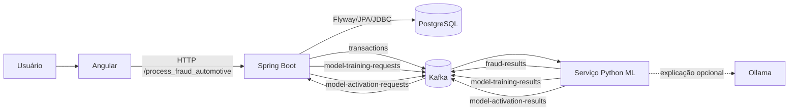

# Arquitetura

## Objetivo do sistema

O projeto implementa uma plataforma de análise de risco de fraude em sinistros automotivos. A solução cobre ingestão de datasets, normalização, inferência assíncrona, consulta analítica, avaliação do modelo, explicabilidade, revisão humana e gestão do ciclo de vida dos modelos.

O desenho separa três necessidades diferentes:

- experiência do usuário e investigação no frontend;
- regras de negócio, persistência e orquestração no backend Java;
- treinamento e inferência estatística no serviço Python.

## Componentes

| Componente | Tecnologia | Responsabilidade |
|---|---|---|
| `fraud-dashboard` | Angular 17, TypeScript, RxJS | Dashboard, importações, exploração de sinistros, gestão visual de modelos e revisão humana. |
| `tcc` | Java 21, Spring Boot 4, Spring Batch, Spring Data JPA | API HTTP, validações, importação em lote, persistência, outbox, consumo e produção Kafka. |
| `ml-fraud-py` | Python 3.11+, pandas, scikit-learn, Joblib | Treinamento, ativação, inferência, explicação local e integração Kafka. |
| PostgreSQL | PostgreSQL 16 | Armazena dados Bronze, Silver, Gold, operações, revisões e metadados de modelos. |
| Kafka | Apache Kafka | Desacopla importação, inferência e gestão dos modelos. |
| Ollama, opcional | API HTTP local | Reescreve a explicação determinística em linguagem natural. Não altera o score. |

## Diagrama lógico



## Arquitetura do backend Java

O backend segue arquitetura hexagonal, também chamada de Ports and Adapters.

```text
adapter/in
  HTTP controllers, Spring Batch, listeners Kafka e scheduler
             |
             v
application/port/in -> application/service -> application/port/out
             |                                  |
             v                                  v
      casos de uso                       contratos externos
                                                |
                                                v
                                      adapter/out
                              PostgreSQL, Kafka e arquivos
```

### Camada de domínio e aplicação

`application/domain` contém os objetos transportados entre casos de uso, como `FraudResult`, `ImportJobView`, `DashboardSummary` e `ConfusionMatrix`.

`application/port/in` declara o que a aplicação oferece: importar dataset, listar sinistros, revisar fraude, consultar dashboard e assim por diante.

`application/port/out` declara o que a aplicação precisa: repositórios, armazenamento de arquivo e produtores de eventos.

`application/service` implementa as regras de negócio sem depender diretamente de controllers ou de detalhes do PostgreSQL.

### Adaptadores de entrada

- `adapter/in`: controllers REST.
- `adapter/in/batch`: leitura e processamento de CSV/Excel com Spring Batch.
- `adapter/in/kafka`: consumo de resultados da inferência e eventos de treinamento/ativação.
- `adapter/in/scheduler`: publicação periódica dos eventos pendentes da outbox.

### Adaptadores de saída

- `adapter/out/persistence`: entidades, repositórios e consultas ao PostgreSQL.
- `adapter/out/kafka`: publicação de eventos.
- `adapter/out/storage`: armazenamento local de datasets.
- `adapter/out/batch`: integração de execução do job.

Essa separação permite trocar a tecnologia externa sem reescrever a regra central. Por exemplo, a regra de revisão humana conhece portas de persistência, mas não conhece SQL.

## Arquitetura do serviço de ML

O serviço Python também separa responsabilidades:

| Área | Responsabilidade |
|---|---|
| `training` | Estratégias supervisionada e de anomalia. |
| `application/training.py` | Orquestra validação, limpeza e seleção da estratégia. |
| `application/scoring.py` | Alinha atributos, calcula score, classe, risco e motivos. |
| `preprocessing.py` | Imputação, One-Hot Encoding e escala numérica. |
| `quality.py` | Remove duplicatas, corrige valores inválidos e elimina identificadores. |
| `normalization.py` | Normaliza nomes, rótulos e tipos de colunas. |
| `infrastructure/kafka.py` | Worker de inferência, retry, commit manual e DLT. |
| `infrastructure/model_repository.py` | Persiste e carrega artefatos Joblib e metadados JSON. |
| `infrastructure/model_management.py` | Treina candidatos e ativa modelos aprovados. |
| `explanation.py` | Explicação determinística ou generativa opcional. |

O worker de inferência recarrega o artefato ativo quando a data de modificação muda. Isso permite ativar um modelo sem reiniciar o processo.

## Arquitetura do frontend

O frontend usa componentes standalone e carregamento preguiçoso por rota.

| Rota | Função |
|---|---|
| `/` | Dashboard, gráfico de decisões, métricas, matriz de confusão e fila de revisão. |
| `/claims` | Exploração e busca dos sinistros normalizados. |
| `/imports` | Upload, acompanhamento, esquema detectado e erros. |
| `/models` | Treinamento, histórico e ativação de modelos. |
| `/transactions/:transactionId` | Detalhe do resultado e revisão humana. |

Os serviços Angular usam o prefixo relativo `/process_fraud_automotive`. Em desenvolvimento, o proxy do Angular direciona essas chamadas ao backend.

### Identificador mostrado ao cliente

O UUID continua sendo a chave técnica no banco e nas APIs, mas a interface calcula uma referência amigável:

```text
SIN-<ano do processamento>-<8 dígitos derivados por hash FNV-1a>
```

Exemplo visual: `SIN-2026-38142017`.

A navegação usa uma chave no formato `case-<Base64 URL-safe do transactionId>`. Isso reduz a exposição visual, mas não substitui um identificador público persistido e opaco. Para uso em produção, o desenho mais forte é criar `public_reference` único no backend e procurar o sinistro por essa referência.

## Comunicação assíncrona

| Tópico | Produtor | Consumidor | Conteúdo |
|---|---|---|---|
| `transactions` | Backend Java | Serviço Python | ID, rótulo conhecido e atributos do sinistro. |
| `fraud-results` | Serviço Python | Backend Java | Score, decisão, risco, versão e explicações. |
| `model-training-requests` | Backend Java | Serviço Python | Solicitação para treinar um candidato. |
| `model-training-results` | Serviço Python | Backend Java | Sucesso/falha, tipo, métricas e artefato candidato. |
| `model-activation-requests` | Backend Java | Serviço Python | Solicitação de ativação de um candidato aprovado. |
| `model-activation-results` | Serviço Python | Backend Java | Resultado da ativação. |
| `transactions.DLT` | Serviço Python | Operação/manual | Mensagens que falharam após todas as tentativas. |

Os nomes podem ser alterados por variáveis de ambiente.

## Por que existe uma outbox

Sem a outbox, salvar uma linha no PostgreSQL e publicar no Kafka seriam duas operações independentes. Se o banco confirmasse e o Kafka falhasse, a transação nunca seria analisada.

O projeto resolve isso assim:

1. a linha Silver e o evento `PENDING` são gravados como parte do processamento;
2. um scheduler busca até 100 eventos pendentes a cada ciclo;
3. a consulta usa `FOR UPDATE SKIP LOCKED`, permitindo mais de um publicador sem disputar o mesmo registro;
4. após o envio, o evento vira `PUBLISHED`;
5. em erro, permanecem tentativas e a última mensagem de falha.

A restrição única `(aggregate_id, event_type)` evita criar o mesmo evento duas vezes para o mesmo sinistro.

## Consistência e idempotência

- O `transactionId` é um UUID determinístico baseado em `importId:sheetName:rowNumber`.
- Bronze tem unicidade por importação, planilha e linha.
- Silver e Gold usam `transactionId` como chave primária.
- A outbox impede eventos duplicados do mesmo tipo por agregado.
- O consumidor Python só confirma o offset depois de publicar o resultado ou enviar a mensagem definitivamente para a DLT.
- A ativação de modelos garante apenas um treinamento com `active = true` no banco.

Isso torna retry seguro dentro do mesmo `importId`. Uma nova importação do mesmo conteúdo, se autorizada, recebe outro `importId` e portanto novos IDs técnicos.

## Segurança atual

O backend é stateless e usa HTTP Basic somente nos endpoints `POST /models/**`, protegidos pela função `MODEL_ADMIN`. Usuário e senha vêm de:

- `MODEL_ADMIN_USER`, padrão `admin`;
- `MODEL_ADMIN_PASSWORD`, padrão `admin-local`.

Todos os demais endpoints usam `permitAll`. Isso é adequado para demonstração local, mas não para ambiente produtivo. Em produção, a recomendação é autenticar todos os endpoints, separar papéis de operador, revisor e administrador, usar TLS, guardar segredos fora do repositório e registrar auditoria de acesso.

## Observabilidade e falhas

O sistema já expõe estados e evidências úteis:

- status e contadores de importação;
- registros rejeitados com o dado original e motivo;
- tentativas e último erro na outbox;
- DLT do Kafka para falhas definitivas de inferência;
- histórico imutável de revisão;
- status e erro de treinamento e ativação.

Ainda faltam métricas operacionais padronizadas, health checks integrados, tracing distribuído e alertas.

## Estado real do ambiente Docker

No `docker-compose.yml` atual, somente PostgreSQL e Kafka estão ativos. Os blocos de backend, serviço de ML, Ollama e frontend existem, mas estão comentados, assim como seus volumes.

Portanto:

- a arquitetura completa acima representa o desenho implementado;
- executar apenas `docker compose up` no estado atual não inicia toda a aplicação;
- os três serviços de aplicação precisam ser executados localmente ou os blocos precisam ser reativados no Compose;
- Ollama é opcional e só participa quando a explicação generativa está habilitada.

## Decisões e trade-offs

| Decisão | Benefício | Limitação |
|---|---|---|
| Dados dinâmicos em JSONB | Aceita datasets com colunas diferentes. | Menos tipagem no banco e consultas de atributos mais caras. |
| Kafka entre ingestão e inferência | Desacopla serviços e absorve picos. | Resultado não é imediato e exige operação do broker. |
| Medalhão Bronze/Silver/Gold | Auditoria e clareza do ciclo do dado. | Mantém mais de uma representação do registro. |
| Random Forest | Bom desempenho em dados tabulares e pouca preparação manual. | Probabilidades podem precisar de calibração e explicação é aproximada. |
| Isolation Forest sem rótulo | Permite operar quando não há verdade conhecida. | Detecta anomalia, não fraude comprovada. |
| Arquivo Joblib | Simples e rápido em ambiente único. | Exige controle de compatibilidade e armazenamento compartilhado em escala. |
| Referência pública calculada no browser | Resolve rapidamente a exibição do UUID. | Pode colidir e não constitui segurança real. |

