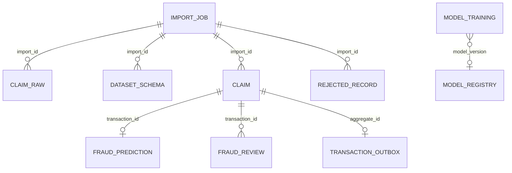

# Banco de dados

## Organização por schemas

O banco usa schemas para deixar explícita a etapa e a responsabilidade de cada dado.

| Schema | Papel |
|---|---|
| `bronze` | Preserva o conteúdo recebido e o esquema descoberto. |
| `silver` | Mantém os sinistros normalizados e utilizáveis. |
| `gold` | Mantém o resultado final da análise do modelo. |
| `ops` | Controla importações, rejeições e entrega de eventos. |
| `review` | Preserva decisões humanas e seu histórico. |
| `ml` | Registra modelos e o ciclo de treinamento/ativação. |



As ligações são principalmente lógicas. As migrações não criam chaves estrangeiras entre essas tabelas, o que reduz acoplamento de escrita e facilita ingestão, mas deixa a integridade referencial sob responsabilidade da aplicação.

## `ops.import_job`

Controla uma importação do início ao fim.

| Coluna | Uso |
|---|---|
| `id` | UUID da importação. |
| `file_name` | Nome original apresentado ao usuário. |
| `stored_path` | Caminho interno onde o arquivo foi salvo. |
| `file_hash` | SHA-256 usado para detectar reenvio do mesmo conteúdo. |
| `status` | `QUEUED`, `PROCESSING`, `COMPLETED`, `COMPLETED_WITH_WARNINGS` ou `FAILED`. |
| `total_rows` | Total de linhas lidas. |
| `processed_rows` | Linhas aceitas em Silver. |
| `rejected_rows` | Linhas registradas como erro. |
| `error_message` | Erro geral do job, se houver. |
| datas | Criação, início e fim. |
| `batch_execution_id` | Vínculo com a execução do Spring Batch. |

Por que existe: o upload retorna antes do processamento terminar. Essa tabela permite acompanhar progresso, retry e diagnóstico sem manter estado apenas na memória.

Índices importantes: data de criação, para listagem recente, e hash, para deduplicação.

## `bronze.claim_raw`

Guarda cada linha como chegou no arquivo.

| Coluna | Uso |
|---|---|
| `id` | Identificador sequencial técnico. |
| `import_id` | Importação que originou a linha. |
| `file_name`, `sheet_name`, `row_number` | Localização exata no arquivo. |
| `original_data` | Objeto JSONB com nomes e valores originais. |
| `source` | Origem/formato do registro. |
| `ingested_at` | Momento da ingestão. |

Por que existe: possibilita auditoria, reprocessamento e comparação entre o que foi recebido e o que foi normalizado. Uma linha rejeitada ainda pode existir em Bronze.

A restrição `(import_id, sheet_name, row_number)` evita duplicação no restart do mesmo job. O índice GIN em `original_data` ajuda pesquisas dentro do JSON.

## `bronze.dataset_schema`

Registra o esquema que foi descoberto dinamicamente.

| Coluna | Uso |
|---|---|
| `original_name` | Nome no arquivo. |
| `normalized_name` | Nome normalizado usado internamente. |
| `inferred_type` | `NULL`, `BOOLEAN`, `NUMBER`, `DATE` ou `STRING`. |
| `column_role` | `FEATURE` ou `LABEL`. |
| `import_id`, `sheet_name` | Contexto da descoberta. |

Por que existe: os datasets não precisam possuir um layout fixo. A interface pode mostrar quais colunas foram identificadas e o backend mantém rastreabilidade da transformação.

## `silver.claim`

É a versão validada do sinistro.

| Coluna | Uso |
|---|---|
| `transaction_id` | Chave determinística da linha processada. |
| `import_id`, `row_number`, `file_name` | Linhagem até a fonte. |
| `normalized_data` | Features normalizadas em JSONB. O rótulo é retirado deste objeto. |
| `confirmed_fraud` | Verdade conhecida do dataset ou da revisão humana; pode ser `null`. |
| `processed_at` | Momento de processamento. |

Por que existe: separa dado utilizável do dado bruto. É a fonte da exploração de sinistros e do evento de inferência.

O índice GIN permite busca no JSONB e o índice por `import_id` acelera consultas de uma importação.

## `gold.fraud_prediction`

Contém a saída do modelo, pronta para dashboard e investigação.

| Coluna | Uso |
|---|---|
| `transaction_id` | Mesmo ID de Silver. |
| `confirmed_fraud` | Rótulo conhecido, usado na matriz de confusão. |
| `predicted_fraud` | Decisão supervisionada; `null` para anomalia. |
| `risk_score` | Número de 0 a 1 retornado pelo ML. |
| `score_type` | `FRAUD_PROBABILITY` ou `ANOMALY_SCORE`. |
| `risk_level` | `LOW`, `MEDIUM` ou `HIGH`. |
| `threshold` | Limiar do artefato utilizado. |
| `classification` | Texto curto de classificação. |
| `model_version` | Versão exata que produziu o resultado. |
| `reasons` | Lista JSONB de impactos locais mais relevantes. |
| `explanation` | Texto explicativo determinístico ou generativo. |
| `explanation_type` | `DETERMINISTIC`, `GENERATIVE` ou `FALLBACK`. |
| `explanation_model` | Modelo generativo, quando utilizado. |
| `processed_at` | Momento em que o backend persistiu a resposta. |

Por que existe: evita recalcular o modelo a cada consulta e concentra dados analíticos. Também registra a versão, permitindo saber por que dois registros semelhantes podem ter resultados diferentes.

Índices cobrem score decrescente, combinação decisão/confirmação e agrupamentos por decisão, risco e modelo.

## `ops.rejected_record`

Armazena linhas que não conseguiram virar Silver.

| Coluna | Uso |
|---|---|
| `import_id`, `file_name`, `row_number` | Localiza a origem. |
| `original_data` | Conteúdo que falhou. |
| `error_reason` | Motivo técnico da rejeição. |
| `rejected_at` | Momento da rejeição. |

Por que existe: um registro ruim não deve derrubar a importação inteira, e o usuário precisa corrigir exatamente a linha problemática.

## `ops.transaction_outbox`

Registra eventos que precisam chegar ao Kafka.

| Coluna | Uso |
|---|---|
| `id` | UUID do evento. |
| `aggregate_id` | `transactionId` do sinistro. |
| `event_type` | Tipo lógico do evento. |
| `payload` | JSON enviado ao Kafka. |
| `status` | Estado de publicação. |
| `attempts`, `last_error` | Diagnóstico de retry. |
| `created_at`, `published_at` | Latência e auditoria. |

Por que existe: oferece entrega eventual confiável entre a transação no banco e o Kafka. A restrição única de agregado e tipo evita duplicatas lógicas.

## `review.fraud_review`

Mantém um registro por decisão humana, sem sobrescrever o histórico anterior.

| Coluna | Uso |
|---|---|
| `transaction_id` | Sinistro revisado. |
| `decision` | `FRAUD`, `LEGITIMATE` ou `INCONCLUSIVE`. |
| `notes` | Justificativa, até 2.000 caracteres. |
| `reviewer` | Identificação do revisor, até 120 caracteres. |
| `reviewed_at` | Data da decisão. |

Por que existe: a confirmação atual em Silver/Gold é mutável; o histórico desta tabela permite auditar quem tomou cada decisão e quando.

A decisão produz o seguinte valor:

| Decisão | `confirmed_fraud` resultante |
|---|---:|
| `FRAUD` | `true` |
| `LEGITIMATE` | `false` |
| `INCONCLUSIVE` | `null` |

## `ml.model_registry`

Registra metadados dos artefatos conhecidos pela aplicação.

| Coluna | Uso |
|---|---|
| `model_version` | Identificador do artefato. |
| `model_type` | `SUPERVISED` ou `ANOMALY`. |
| `feature_schema` | Colunas esperadas pelo modelo. |
| `metrics` | Métricas calculadas no treinamento. |
| `threshold` | Limiar do modelo. |
| `active` | Indica se pode ser usado para inferência. |
| `trained_at` | Momento do treinamento. |

Por que existe: a aplicação precisa conhecer o modelo ativo antes de aceitar importações e precisa ligar cada decisão à sua versão.

## `ml.model_training`

Controla o workflow administrativo de candidatos.

| Coluna | Uso |
|---|---|
| `id` | UUID da solicitação. |
| `file_name`, `stored_path`, `dataset_hash` | Dataset de treinamento e sua integridade. |
| `status` | Estado do ciclo de vida. |
| `requested_by`, `requested_at` | Autor e início. |
| `model_version`, `model_type` | Modelo gerado. |
| `candidate_artifact_path` | Local do artefato ainda não ativo. |
| `row_count`, `feature_count`, `target_column` | Resumo do dataset. |
| `metrics` | Métricas serializadas. |
| `error_message` | Falha de treinamento ou ativação. |
| `active`, `activated_at`, `activated_by` | Estado e auditoria da ativação. |

Estados possíveis:

```text
QUEUED -> TRAINING -> READY -> ACTIVATING -> ACTIVE
             |                       |
             v                       v
           FAILED              ACTIVATION_FAILED
```

O índice parcial único em `active = true` garante no banco que apenas um treinamento fique ativo.

## Tabelas do Spring Batch

Além das tabelas de domínio, o Spring Batch cria suas tabelas de metadados. Elas registram job instances, executions, steps e execution contexts. O backend configura `initialize-schema: always` e desabilita execução automática de jobs na inicialização.

Essas tabelas existem para restart e acompanhamento interno do processamento em lote. Não são a fonte principal exibida ao usuário; `ops.import_job` traduz esse estado para o domínio do produto.

## Linhagem de um registro

```text
ops.import_job.id
  -> bronze.claim_raw.import_id
  -> silver.claim.import_id

bronze.claim_raw(import_id, sheet_name, row_number)
  -> UUID determinístico
  -> silver.claim.transaction_id
  -> ops.transaction_outbox.aggregate_id
  -> gold.fraud_prediction.transaction_id
  -> review.fraud_review.transaction_id
```

## Migrações

As migrações Flyway `V1` a `V8` criam os schemas e tabelas, adicionam outbox e catálogo dinâmico, vinculam Spring Batch, migram tabelas legadas, adicionam gestão de modelos, explicação generativa e índices analíticos.

O Hibernate usa `ddl-auto: validate`: ele valida o mapeamento, mas não deve alterar o schema. A evolução do banco deve continuar sendo feita por novas migrações Flyway.

