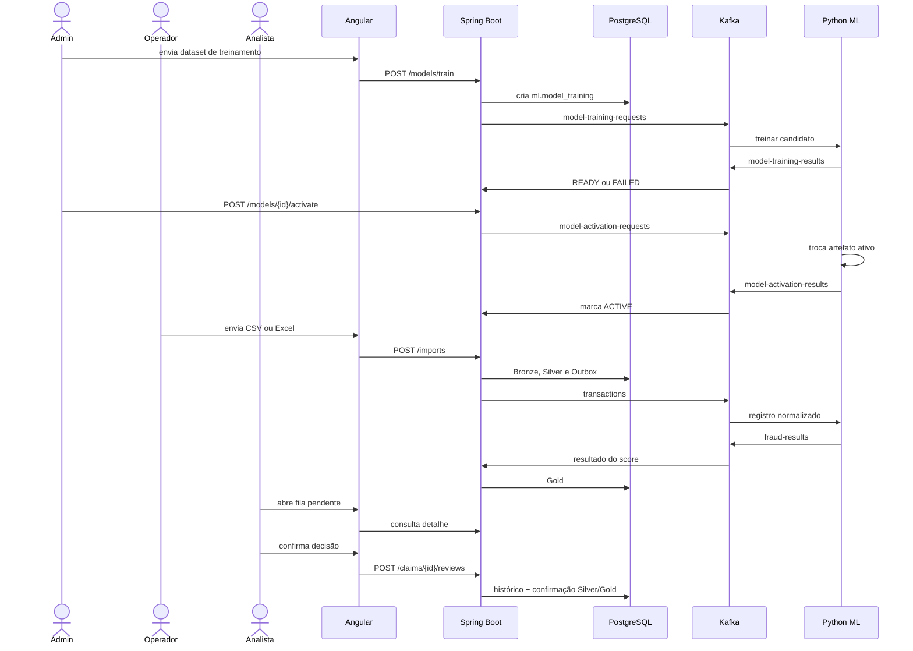

# Fluxo completo do projeto

## Visão ponta a ponta

Existem três fluxos principais:

1. um administrador treina e ativa um modelo;
2. um operador importa sinistros e aguarda a análise assíncrona;
3. um analista investiga os resultados e registra a conclusão humana.



## Fluxo 1: treinamento e ativação

### 1. Upload administrativo

O administrador envia CSV, XLS ou XLSX em `POST /models/train`. O endpoint exige HTTP Basic e função `MODEL_ADMIN`.

O backend valida nome, extensão, conteúdo não vazio e tamanho. Em seguida:

1. gera um `trainingId`;
2. armazena o arquivo e calcula SHA-256;
3. cria `ml.model_training` como `QUEUED`;
4. muda o status para `TRAINING`;
5. publica uma solicitação em `model-training-requests`.

Se a publicação falhar, o registro vira `FAILED` com a mensagem de erro.

### 2. Preparação do dataset no Python

O worker lê o arquivo com pandas, normaliza os nomes, remove duplicatas exatas, substitui alguns dados inválidos por ausentes e elimina identificadores.

Se encontrar uma coluna alvo reconhecida, escolhe treinamento supervisionado. Caso contrário, escolhe detecção de anomalia.

### 3. Treinamento do candidato

No supervisionado, o serviço cria um holdout estratificado, treina uma Random Forest, calcula métricas e depois ajusta o pipeline novamente em todos os exemplos rotulados.

Na anomalia, treina um Isolation Forest e calcula referências de calibração a partir dos percentis 5 e 90 dos scores de treino.

O artefato é salvo em:

```text
<candidate_directory>/<trainingId>.joblib
```

Também é produzido um manifesto JSON. O resultado `READY` ou `FAILED` volta por `model-training-results` e atualiza `ml.model_training`.

### 4. Aprovação e ativação

Treinar não ativa automaticamente. O administrador escolhe um candidato `READY` e chama o endpoint de ativação.

O fluxo é:

```text
READY -> ACTIVATING -> ACTIVE
                    -> ACTIVATION_FAILED
```

O serviço Python carrega o candidato e o salva no caminho do artefato ativo. O backend desativa o modelo anterior, ativa o novo em `ml.model_training` e atualiza `ml.model_registry`.

O worker de inferência verifica a data de modificação do arquivo e recarrega o modelo quando percebe a troca.

## Fluxo 2: importação de sinistros

### 1. Validação do upload

Ao receber `POST /imports`, o backend exige:

- nome de arquivo não vazio;
- conteúdo maior que zero;
- tamanho de até 50 MiB por padrão;
- extensão `.csv`, `.xls` ou `.xlsx`;
- presença de um modelo ativo em `ml.model_registry`.

O arquivo é salvo com um nome seguro associado a um novo `importId`, e seu SHA-256 é calculado.

### 2. Deduplicação

O backend procura o mesmo hash em importações com estado:

```text
QUEUED, PROCESSING, COMPLETED ou COMPLETED_WITH_WARNINGS
```

Se encontrar, descarta a nova cópia e retorna o job existente. Importações `FAILED` não bloqueiam um novo envio.

### 3. Execução em lote

Uma nova importação começa em `QUEUED` e é enviada ao Spring Batch. Antes do job, vira `PROCESSING`.

O step usa chunks de 100 registros. O leitor grava no `ExecutionContext` quantos registros já foram lidos. Em retry, ele reabre o arquivo e avança até essa posição.

### 4. Leitura de CSV

- codificação UTF-8;
- primeira linha como cabeçalho;
- separador padrão CSV, vírgula;
- espaços laterais removidos;
- linhas vazias ignoradas;
- nome lógico da planilha: `CSV`.

O `rowNumber` considera o cabeçalho, por isso o primeiro registro de dados normalmente aparece como linha 2.

### 5. Leitura de Excel

- lê `.xls` e `.xlsx` em modo somente leitura;
- percorre todas as planilhas;
- em cada planilha, a primeira linha não vazia é o cabeçalho;
- cabeçalhos vazios viram `column_1`, `column_2` etc.;
- linhas totalmente vazias são ignoradas;
- preserva números, booleanos e datas como tipos nativos quando possível.

### 6. Normalização da linha

Os nomes de coluna seguem a mesma transformação descrita no documento de modelos. Nomes vazios, nomes acima de 120 caracteres depois da normalização e duplicatas normalizadas rejeitam a linha.

Para valores textuais, a ordem de tentativa é:

1. booleano;
2. data em `yyyy-MM-dd`, `dd/MM/yyyy` ou `dd-MM-yyyy`;
3. moeda brasileira, como `R$ 1.234,56`;
4. inteiro;
5. decimal com ponto ou vírgula;
6. texto original aparado.

Texto vazio vira `null`. Valores que já vieram tipados do Excel são preservados.

### 7. Separação da label

Se uma coluna reconhecida como label estiver presente, seu valor é convertido para `true`, `false` ou `null`. A label não entra em `normalized_data`; ela vai para `confirmed_fraud`.

Isso evita vazamento de alvo: o modelo não pode receber como feature a resposta que deveria prever.

### 8. Geração do identificador interno

O ID é determinístico:

```text
seed = importId + ":" + sheetName + ":" + rowNumber
transactionId = UUID.nameUUIDFromBytes(seed em UTF-8)
```

Essa regra garante que reprocessar a mesma linha da mesma importação gere a mesma chave. O UUID não deve ser apresentado como número de sinistro ao cliente final.

### 9. Escrita Bronze/Silver ou rejeição

Para cada linha, o writer sempre grava Bronze.

Se aceita:

1. grava Silver;
2. registra o esquema descoberto;
3. cria o evento na outbox.

Se rejeitada:

1. não grava Silver;
2. grava `ops.rejected_record` com conteúdo original e motivo.

Ao terminar:

| Situação | Status |
|---|---|
| Todas as linhas válidas | `COMPLETED` |
| Job terminou, mas houve linhas rejeitadas | `COMPLETED_WITH_WARNINGS` |
| O job falhou | `FAILED` |

Os contadores finais são obtidos das quantidades persistidas em Silver e na tabela de rejeições.

## Fluxo 3: publicação e inferência

### 1. Publicação da outbox

A cada segundo por padrão, o scheduler seleciona até 100 eventos `PENDING`, ordenados por criação, usando lock com `SKIP LOCKED`.

O evento enviado a `transactions` contém conceitualmente:

```json
{
  "transactionId": "...",
  "realFraud": null,
  "features": {
    "idade": 42,
    "valor_sinistro": 18750.0
  }
}
```

Em sucesso, a outbox vira `PUBLISHED`. Em falha, incrementa tentativas e registra `last_error`.

### 2. Recepção pelo worker Python

O consumidor valida:

- payload como objeto JSON;
- `transactionId` como texto;
- `features` como objeto não vazio;
- `realFraud` como booleano ou `null`.

As features são normalizadas e alinhadas às colunas do treinamento:

- colunas ausentes viram ausentes e são imputadas;
- colunas novas não usadas pelo modelo são descartadas;
- categorias desconhecidas são ignoradas pelo encoder.

### 3. Cálculo do resultado

No modelo supervisionado:

```text
probability = probabilidade da classe fraude
predictedFraud = probability >= threshold
scoreType = FRAUD_PROBABILITY
```

No modelo de anomalia:

```text
probability = score de anomalia calibrado entre 0 e 1
predictedFraud = null
scoreType = ANOMALY_SCORE
```

Depois são calculados `riskLevel`, `classification`, até três `reasons` e a explicação textual.

### 4. Retry e DLT

O consumidor usa commit manual. Se o processamento falhar, tenta novamente até `KAFKA_MESSAGE_MAX_RETRIES`, padrão 3. Entre tentativas espera o intervalo configurado.

Após a última falha, publica em `transactions.DLT`:

```json
{
  "source": {},
  "error": "mensagem da falha",
  "topic": "transactions",
  "partition": 0,
  "offset": 123
}
```

Só então confirma o offset, isolando a mensagem ruim sem bloquear toda a partição indefinidamente.

### 5. Retorno e persistência Gold

O Python publica em `fraud-results`. O backend valida e normaliza o score:

- aceita `probability` ou o campo legado `riskScore`;
- se o valor for maior que 1, divide por 100;
- rejeita valores fora de 0 a 1 ou não finitos;
- aplica fallbacks para campos de versões antigas.

O resultado é gravado em `gold.fraud_prediction`. Nesse momento ele passa a aparecer no dashboard.

## Por que os totais podem divergir

Em um sistema assíncrono, isto é esperado:

```text
Bronze >= Silver >= Gold, normalmente
```

- Bronze pode conter linhas rejeitadas.
- Silver contém apenas linhas aceitas.
- Gold só aparece depois da publicação, inferência, retorno Kafka e consumo Java.
- uma falha na DLT pode deixar uma linha Silver sem Gold até intervenção.

O número total de rejeições pode vir de várias importações e não precisa ser apenas `Bronze - Silver` se houver dados legados ou reprocessamentos.

## Fluxo 4: dashboard

Ao abrir `/`, o frontend busca:

- resumo de volumes e risco;
- resultados filtráveis;
- matriz de confusão;
- fila de revisão pendente.

O gráfico de rosca divide resultados supervisionados em:

- fraude prevista;
- legítimo previsto;
- previsão pendente, quando `predictedFraud` é `null`.

Ao selecionar fraude ou legítimo, o frontend chama `decision-details` e mostra quantidade, percentual, média, faixas de risco, modelo predominante e motivos frequentes. A listagem detalhada usa os filtros do backend, e não uma aproximação feita no navegador.

## Fluxo 5: fila de revisão humana

Um caso é pendente quando `realFraud`/`confirmedFraud` é `null`. A fila pendente é ordenada por:

1. maior score;
2. resultado mais recente.

O analista abre o detalhe, observa:

- referência amigável;
- score e seu tipo;
- decisão e nível de risco;
- limiar;
- versão do modelo;
- motivos e explicação;
- features normalizadas;
- histórico de revisões.

Ao decidir, o backend cria uma nova linha em `review.fraud_review` e atualiza Silver e Gold na mesma transação.

```text
FRAUD       -> confirmedFraud = true
LEGITIMATE  -> confirmedFraud = false
INCONCLUSIVE-> confirmedFraud = null
```

Uma decisão inconclusiva mantém ou devolve o caso à fila pendente. O histórico anterior não é apagado.

## Como a revisão afeta as estatísticas

A revisão não altera o que o modelo previu originalmente. Ela altera apenas a confirmação.

Exemplo:

```text
Antes da revisão:
  predictedFraud = true
  confirmedFraud = null
  fora da matriz de confusão

Depois de LEGITIMATE:
  predictedFraud = true
  confirmedFraud = false
  entra como falso positivo
```

Assim, a matriz de confusão evolui conforme mais casos recebem decisão humana. Isso transforma o dashboard em um acompanhamento operacional do desempenho em produção.

## Exemplo completo de interpretação

Considere este resultado:

```json
{
  "realFraud": false,
  "predictedFraud": true,
  "probability": 0.82,
  "scoreType": "FRAUD_PROBABILITY",
  "riskLevel": "HIGH",
  "threshold": 0.5,
  "modelVersion": "supervised-rf-20261015122510-ab12cd34",
  "reasons": [
    "Valor sinistro aumentou o risco estimado em aproximadamente 11,0 pontos percentuais."
  ]
}
```

Leitura correta:

1. é um modelo supervisionado, então `0.82` é a probabilidade estimada da classe fraude;
2. como `0.82 >= 0.50`, a decisão foi fraude;
3. como `0.82 >= 0.70`, o risco visual é alto;
4. retirar `valor_sinistro` e imputar a referência reduziu o score em cerca de 0.11, então o valor presente aumentou localmente o risco;
5. `realFraud = false` mostra que dataset ou analista confirmou legítimo;
6. portanto, na matriz de confusão este caso é falso positivo;
7. isso não prova que `valor_sinistro` causou o erro, apenas que influenciou a previsão daquele modelo naquele registro.

## Caminho para diagnosticar um caso incorreto

1. Localize a referência visual e recupere o `transactionId` usado internamente.
2. Consulte o detalhe Gold e anote `modelVersion`, `scoreType`, score e threshold.
3. Consulte Silver para ver as features efetivamente enviadas.
4. Consulte Bronze para comparar nomes e valores originais.
5. Verifique se a label original foi reconhecida e removida das features.
6. Confira os motivos locais e se houve imputação por campo ausente.
7. Compare o caso com as métricas do modelo correto, não apenas com o modelo ativo hoje.
8. Consulte o histórico de revisão para saber se a confirmação mudou.
9. Se não houver Gold, examine outbox, logs do worker e `transactions.DLT`.

## Estado atual versus comportamento desejado em produção

O fluxo funcional está implementado, mas o ambiente ainda tem pontos de evolução:

- no Compose atual, só PostgreSQL e Kafka estão habilitados;
- autenticação não cobre consultas, importações e revisões;
- a referência pública existe apenas no frontend;
- o registro SQL do modelo ativo não recebe ainda o schema e threshold do artefato;
- não existe endpoint ou tela dedicada à DLT e ao reprocessamento de mensagens;
- não há versionamento formal do contrato Kafka;
- não há monitoramento de drift do modelo ou calibração das probabilidades.

Esses itens não mudam a leitura do fluxo atual, mas são importantes antes de usar a solução como serviço produtivo.

